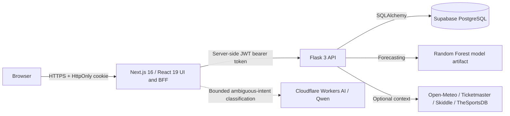
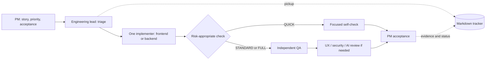

# RFS — Restaurant Forecasting System

RFS is a single-restaurant dissertation prototype for planning services. It combines bookings, short-term demand forecasts, staffing guidance, saved management reports, and selected external context in a role-protected web app. Forecasts and financial figures are decision support, not guaranteed outcomes or accounting statements.

The [Product Requirements Document](docs/PRD.md) is the main product reference. The [improvement tracker](docs/IMPROVEMENT_TRACKER.md) is the source of truth for delivery and verification status; a deployed feature is not automatically marked Done.

## Current product

- Dashboard: current date selection, observed and predicted covers, staffing and revenue estimates, and accessible charts.
- Bookings and forecasts: protected booking changes update daily demand; seven- or ten-day forecasts respect Monday closure. Immutable forecast runs preserve earlier predictions. Forecast Accuracy compares eligible pre-service predictions with manually entered served covers; its separate demo sample is explicitly synthetic.
- Staff and settings: managers can administer staff accounts and staffing rules. Settings combines own-account fields with manager-authorized Staffing Rules. Supervisors can use operational views but cannot administer accounts; staff can access their own profile.
- Reports: the Reports page is **view-only** for saved snapshots. The manager-only RFS AI assistant generates, saves, retrieves, and downloads reports as PDF or CSV through protected APIs. Reports contain aggregate operational data, not customer names or booking notes.
- RFS AI: its launcher sits below the left navigation. On desktop the chat opens as a left dock and shifts the page rather than covering it; on smaller screens it stays in flow. It shows restaurant weather when opened and accepts typed requests for events, bookings/forecasts, reports, and a protected in-chat Staff Management workspace. Suggested prompts fill the composer but do not send a request automatically. Cloudflare Workers AI/Qwen classifies ambiguous requests when configured; explicit supported requests use deterministic routing. The model does not authorize actions or receive raw staff records.
- Notifications: a real, recipient-scoped inbox shows completed report-save events with unread/read state. Weather and event-provider failures do not block core forecasting or reports.

The app has **no POS integration**. Booking totals are not actual guests served; genuine forecast accuracy requires a completed service and a manually recorded actual. Current release and acceptance gaps are recorded under [#21](docs/FORECAST_ACCURACY.md), [#54–55](docs/IMPROVEMENT_TRACKER.md), and [#57](docs/RFS_UI_UX_REDESIGN_PLAN.md).

## Architecture

The browser calls same-origin Next.js routes, not PostgreSQL or the Supabase Data API. Next.js stores the Flask-issued JWT in an HttpOnly session cookie and forwards protected requests with a server-side bearer token. Flask checks the current account and permissions and remains authoritative for booking, forecast, report, staff, and notification operations. Cloudflare credentials remain server-side; the model only classifies ambiguous text into an allowlisted intent. Saved reports and notification events are persisted in PostgreSQL. Optional provider results use a backend instance cache, so context can be unavailable on a cold instance.

The frontend and backend are separate Vercel projects. Supabase migrations are a separate release step; pushing code does not apply them. See [database setup and migration history](supabase/README.md) and the tracker for open migration/access checks.

## Repository map

| Path | Purpose |
|---|---|
| [`frontend/`](frontend/) | Next.js pages, protected API proxy, manager assistant, and UI tests |
| [`backend/`](backend/) | Flask routes, services, forecasting, reports, and pytest tests |
| [`supabase/migrations/`](supabase/migrations/) | Ordered, forward-only PostgreSQL schema changes |
| [`docs/`](docs/README.md) | PRD, current backlog, design decisions, and implementation evidence |
| [`.agents/skills/`](.agents/skills/) and [`AGENTS.md`](AGENTS.md) | Sequential PM-led delivery roles and coordination rules |

## Run locally

Prerequisites: Node.js/npm, Python 3/pip, and an authorized PostgreSQL database. Do not commit credentials or real session links.

1. Install the root and frontend packages: `npm install`, then `npm --prefix frontend install`.
2. Create a Python virtual environment at `backend/venv` and install `backend/requirements.txt` (plus `backend/requirements-dev.txt` to run tests).
3. Copy [`backend/.env.example`](backend/.env.example) to `backend/.env` and configure the JWT key, PostgreSQL connection, restaurant location, and any optional event keys. Set `BACKEND_API_URL=http://127.0.0.1:5000/api` in a private `frontend/.env`; do not prefix it with `NEXT_PUBLIC_`.
4. On Windows, run `npm run dev` from the repository root. This starts Next.js at `http://localhost:3000` and Flask at `http://127.0.0.1:5000`. The root backend script uses `backend/venv/Scripts/python.exe`; on other platforms start Flask with the activated virtual environment instead.

For the manager assistant's optional ambiguous-intent model, configure `CLOUDFLARE_ACCOUNT_ID` and `CLOUDFLARE_API_TOKEN` **only** in the frontend server environment. Keep the token out of Git and browser variables. Explicit supported chat requests can work without model configuration. The separate AI report-explanation pilot is disabled by default; see [its release gates](docs/AI_REPORT_EXPLANATIONS.md).

### Checks

From `frontend/`, run `npm run lint`, `npm run test:unit`, `npm run test:components`, `npm run test:routes`, and `npm run build`. With the backend virtual environment active and development requirements installed, run `python -m pytest` from `backend/`. Some local Next.js builds in this OneDrive checkout have encountered Windows file locks; the tracker records when an alternate clean output directory was used for verification.

## Deployment and verification

GitHub `main` is connected to separate Vercel frontend and backend projects. The [live frontend](https://dissertation-valeriogerardi-5538s-projects.vercel.app/) is a controlled prototype, not a claim of commercial readiness. Apply and verify new Supabase migrations before code that depends on them is released. After deployment, check health, authenticated manager and restricted-role journeys, relevant data changes, and runtime errors. [The tracker](docs/IMPROVEMENT_TRACKER.md) records Git, Supabase, Vercel, and end-to-end verification separately.

## PM-led agentic delivery team

The Product Manager (you) owns scope, priorities, and final product acceptance. `AGENTS.md` coordinates reusable project skills; it does not create agents that run continuously. For each task, the engineering lead chooses a QUICK, STANDARD, or FULL path. Specialists work **one at a time**, with independent QA and risk-based UX, security, or AI evaluation when needed. An implementer cannot approve their own non-trivial work. No Trello board is used; the Markdown tracker is canonical.

See [the team workflow](docs/RFS_AI_TEAM_WORKFLOW.md) for the eight roles and handoff requirements. The team configuration is currently **Partial** under tracker #58 until a real feature has completed the sequential handoff and PM acceptance. A role never grants permission to merge to `main`, deploy, or change production data without PM approval.

## Documentation and limitations

Start with the [PRD](docs/PRD.md), then use the [docs index](docs/README.md) to find the architecture, design, and release notes. The project is a single-restaurant academic prototype. Forecast quality depends on representative historical and served-actual data; live chatbot inference, staff-write idempotency, responsive/accessibility checks, genuine accuracy comparisons, and some migration/access gates still require verification. Consult the tracker before treating any feature as fully tested.

## Author

Valerio Gerardi — Dissertation Project, Southampton Solent University
