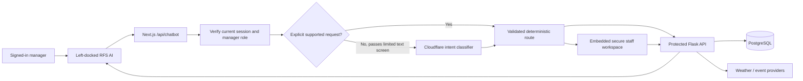
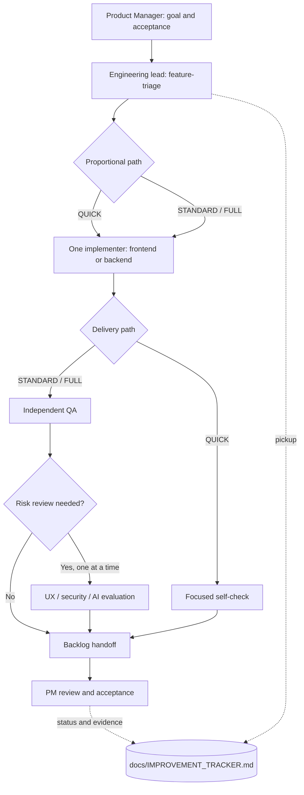

# RFS agentic capabilities and delivery framework

**Current-state guide — 31 October 2026.** This document covers two different kinds of “agent”: the manager-facing RFS AI assistant in the product, and the PM-led specialist workflow used to develop the product. They are not one autonomous system. The [PRD](PRD.md) owns product requirements; the [tracker](IMPROVEMENT_TRACKER.md) owns completion and release status. The [architecture guide](ARCHITECTURE.md) owns system-wide component boundaries.

## 1. Manager-facing RFS AI

RFS AI is a **manager-only, typed assistant** launched below the left navigation. On desktop it opens as a 400 px dock beside the 240 px sidebar, shifting the dashboard instead of covering it; on smaller screens it appears in normal flow. It greets the manager, retrieves weather when opened, and offers suggested requests that **fill the composer but do not send**. The manager must submit a request.

| Request | Current behaviour | Boundary |
| --- | --- | --- |
| Weather | Fetches the restaurant weather on open and on request. | Protected Flask weather API; no model required. |
| Local events | Retrieves date-bounded nearby events and source context. | Protected event API; provider results can be unavailable. This is not an all-London event guarantee. |
| Bookings and forecasts | Summarises today's bookings, reservation demand, and staffing recommendations. | Read-only, source-derived answers; predictions are not completed bookings or a rota. |
| Reports | Generates, saves, finds, views, and downloads management reports in chat. | Protected report APIs; the Reports page itself only lists and displays saved snapshots. |
| Staff Management | Opens an embedded secure workspace for search, detail, registration, editing, status changes, and reset-link actions. | Existing protected forms and explicit confirmation perform writes; the model never executes a staff mutation. |

Explicit supported requests are routed by deterministic code. For an ambiguous request, the Next.js server may send the **user-typed message** to Cloudflare Workers AI (`@cf/qwen/qwen3.8-27b`) for classification into an allowlisted intent. It screens obvious identifiers/secrets such as `@`, password, token, secret, and reset-link terms, but that filter is **not a complete personal-data detector**; a user could still type sensitive information in other forms. The model does not receive Flask results, raw staff records from the backend, or an executable tool. Its output is not an authorization decision. A privacy review and stronger input controls remain open. Without model credentials or during a model failure, direct requests can still work; ambiguity receives a safe fallback.

The chat route validates origin, JSON size, message/context, session, and manager access before a bounded request. Flask remains the authority for permissions and business rules. Staff write reliability is **not complete**: durable idempotency, privacy/usage limits, live model inference, and authenticated manager/restricted-role end-to-end checks are open under [#54–55](IMPROVEMENT_TRACKER.md). The separate saved-report AI-explanation pilot [#52](AI_REPORT_EXPLANATIONS.md) is disabled and is **not** part of the current chatbot.

## 2. PM-led specialist team

The repository contains reusable skills, **not persistent background agents**. The user is Product Manager and owns scope, priority, and final acceptance. `AGENTS.md` at the repository root coordinates handoffs; `.agents/skills/` contains the role instructions. Specialists work **sequentially**, not in parallel. Trello is disabled; the Markdown tracker is the only actionable backlog.

| Skill | When it is used | Responsibility |
| --- | --- | --- |
| `feature-triage` | Task pickup or scope change | Define acceptance and select QUICK, STANDARD, or FULL. |
| `frontend-implementation` | Approved Next.js/UI change | Implement and self-check the frontend. |
| `backend-implementation` | Approved Flask/data/API change | Implement and self-check the backend. |
| `quality-assurance` | Non-trivial implementation or release | Independently test criteria and regressions. |
| `ux-design-review` | Material manager-workflow or visual change | Review usability, responsive behaviour, and accessibility. |
| `security-review` | Sensitive data or action boundary | Review authorization, exposure, injection, and unsafe automation. |
| `ai-chatbot-evaluation` | Chatbot model, intent, or tool change | Evaluate routing, safety, and unsupported claims. |
| `backlog-handoff` | Task-state change or completion | Record evidence and accurate status in the tracker. |

QUICK uses a focused self-check for an isolated low-risk change; STANDARD adds independent QA; FULL adds only the risk reviews needed. An implementer cannot approve their own non-trivial work. A handoff records the task ID, changed files, actual checks, gaps, and next decision. After two unsuccessful fix/retest cycles, report the blocker. Skills do not authorize a `main` merge, deployment, or production data change. The legacy `move-board-cards` skill is dormant unless the PM explicitly reverses the no-Trello rule.

**Current evidence:** the skills and workflow are installed and their configuration was independently reviewed, but tracker [#58](IMPROVEMENT_TRACKER.md) remains Partial until a real feature completes the full sequence and PM acceptance. See the [workflow history](RFS_AI_TEAM_WORKFLOW.md) for the original setup record and the [chatbot technical note](RFS%20Chatbot%20Architecture%20Design.md) for deeper implementation boundaries.

## 3. Rules shared by both kinds of agent

- No model output or specialist role grants permissions. The authenticated backend and PM decision respectively remain authoritative.
- Keep user/customer/staff secrets out of prompts, logs, reports, and browser variables.
- Show source data, dates, estimates, and unavailable states honestly; never invent event coverage, report totals, or forecast accuracy.
- Require explicit human review for sensitive writes and record actual test evidence before calling work Done.
