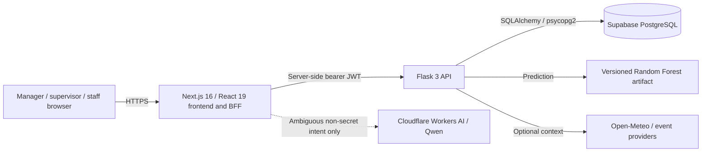
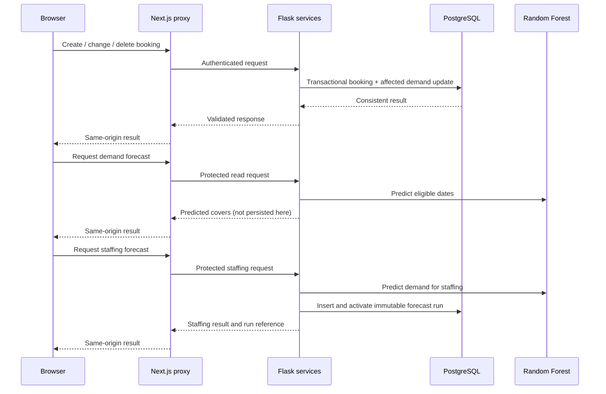

# RFS system architecture

**Current-state guide — 31 October 2026.** This is the overall component and data-flow reference for the single-restaurant dissertation prototype. The [PRD](PRD.md) owns product requirements, the [agent guide](AGENT.md) covers both assistant and delivery agents, and the [tracker](IMPROVEMENT_TRACKER.md) owns implementation/release evidence. Diagrams show deployed code boundaries, not a claim that every end-to-end acceptance check has passed.

## System context and deployment

The frontend and backend are separate Vercel projects. Supabase is a separate managed database and migration release step. The browser uses same-origin Next.js routes; it has no direct PostgreSQL connection or Cloudflare credential. `BACKEND_API_URL` points the Next.js server to the Flask API. Flask issues the session JWT and checks current account state and permissions; Next.js stores the token in an HttpOnly cookie, validates protected pages, and forwards it in server-side requests. Mutating proxy requests reject mismatched origins. Frontend visibility is usability, **not** authorization.

## Components and ownership

| Component | Responsibility | Primary implementation |
| --- | --- | --- |
| Next.js App Router UI | Signed-in shell, dashboard, bookings, forecasts, staff, view-only Reports, Settings, notifications, RFS AI. | `frontend/src/app/dashboard/`, `frontend/src/components/` |
| Next.js BFF | Auth cookie routes, same-origin backend proxy, manager chatbot orchestration, disabled AI report-explanation route. | `frontend/src/app/api/` |
| Flask API | Authentication, permission checks, request validation, booking/demand, forecast, staffing, reports, events/weather, notifications. | `backend/app/api/`, `controllers/`, `services/` |
| ML pipeline | Train and load the Random Forest demand model, produce short-horizon predictions. | `backend/app/ml/` |
| PostgreSQL | Application records, immutable forecast runs, served-cover actuals, saved report snapshots, notification inbox. | `supabase/migrations/`, `backend/app/db/` |
| External context | Weather and nearby events; optional and isolated from core reports/forecasts. | `backend/app/services/weather_service.py`, `events_service.py` |
| Cloudflare classifier | Classify only ambiguous chatbot text into allowlisted intents; no business-data or staff-write authority. | `frontend/src/lib/chatbot-model.mjs` |

The app supports one configured restaurant/location. Manager, supervisor, and staff are application roles: managers administer staff/rules and use RFS AI; supervisors can use permitted operational views; staff have own-profile access. The Flask permission map is authoritative; the shared dashboard layout and sidebar apply matching UI guards.

## Main data flows

### Booking to demand and forecast

Booking mutations and their demand aggregates are designed to be atomic. Forecasts respect configured closed days and are estimates, not booking totals or actual guests served. The standalone demand-forecast endpoint predicts without saving a run; the staffing-forecast path persists an immutable run and activates it for later comparison. There is **no POS integration**: an authorised person enters served-cover actuals after service. The forecast-accuracy feature distinguishes real actuals from synthetic demo fixtures; genuine pre-service versus completed-service and role journeys still require release verification ([#21](IMPROVEMENT_TRACKER.md)).

### Reports and notifications

The manager asks RFS AI to generate, save, retrieve, or download a management report. Next.js calls protected Flask report endpoints; Flask calculates from canonical operational data and generates JSON/PDF/CSV without trusting browser-submitted totals. Saved snapshots are immutable and available for 90 days through authenticated, user/format-bound downloads. The sidebar Reports page only views stored snapshots. A successful save inserts a recipient-scoped `report_saved` notification in the same database transaction. The bell reads a bounded inbox and marks only the signed-in recipient's rows read. The migration was applied and RLS/grants checked, but a live end-to-end notification event and cross-user browser checks remain open ([#57](IMPROVEMENT_TRACKER.md)).

### Manager assistant

`GET /api/chatbot` verifies a manager session and fetches weather without a model call. `POST /api/chatbot` validates the request, routes explicit commands deterministically, and may send an ambiguous **user-typed message** to Cloudflare Workers AI after a limited obvious-secret screen. That screen is not comprehensive personal-data protection; privacy review and stronger controls remain open. The route then calls fixed protected Flask endpoints or opens the embedded Staff Management workspace. The model never receives backend records or executes mutations. Secure forms and confirmation handle staff writes; durable idempotency and live model/usage checks remain open. The separate AI saved-report explanations pilot is feature-gated **off** and not a current Reports-page control. See [AGENT.md](AGENT.md) and [#54–55](IMPROVEMENT_TRACKER.md).

## Data and security boundaries

- The database schema is an ordered, forward-only chain under `supabase/migrations/`; the [migration guide](../supabase/README.md) records safe replay procedures. Git push, migration application, and Vercel deployment are distinct states.
- Application tables holding private data are server-only in the intended access model, with RLS and revoked client grants where applied; complete project-wide access/default-grant verification remains tracked under [#3–4](IMPROVEMENT_TRACKER.md).
- Flask authenticates protected blueprints and checks the permission associated with each operation. Report and notification services filter data by authorization/recipient. Session and provider secrets must not enter model prompts or browser variables.
- Optional provider failures should produce warnings or unavailable states without blocking core booking, forecasting, or reporting. Provider caches are instance-local, not a distributed cache.
- The prototype is not multi-tenant; scaling to high traffic or multiple restaurants would require deliberate tenancy, storage/cache, background-work, and performance decisions rather than assuming the current serverless boundaries suffice.

## Verification and known limits

Use the [tracker](IMPROVEMENT_TRACKER.md) for the exact status of each increment. Current gaps include authenticated role and responsive checks for the redesigned UI, durable staff-write idempotency, live assistant model/privacy/usage evaluation, real-data accuracy evidence, some migration/access gates, and broader end-to-end coverage. A Vercel READY state or passing unit test does not close these gaps. Historical design and release notes remain indexed in [docs/README.md](README.md); this guide is the concise current architecture map.
