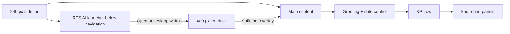

# RFS visual design system

**Current-state guide — 31 October 2026.** This describes the signed-in interface implemented in `frontend/src/app/rfs-redesign.css`, shared components, and dashboard pages. It is a descriptive design contract, not a claim that all screens have completed visual QA. The [PRD](PRD.md) owns product behaviour, [#57](IMPROVEMENT_TRACKER.md) owns release acceptance, and the [original approved dashboard image](RFS%20Restaurant%20Analytics%20Dashboard.png) remains a visual reference. Later PM decisions supersede the image where they differ.

## Visual direction

Use a restrained restaurant-red accent, dark navy text, white surfaces, and a pale neutral canvas. The interface should feel calm and operational: high-value numbers and trends first, secondary detail on demand. The current dashboard has a compact account/notification area **without a full-width white top strip**, a greeting/date header near the top, a KPI row, and four charts. The earlier context and quick-action cards below the charts were removed. Never recreate sample figures from the mockup; all displayed values must come from live app data or be explicitly labelled demo data.

## Implemented visual vocabulary

These are values observed in the current stylesheet, not yet a fully centralized token package. New UI should reuse the same semantic roles; avoid adding another red/gray scale without a deliberate design review.

| Role | Current value / treatment | Usage |
| --- | --- | --- |
| Canvas | `#fafbfc` | Signed-in shell and page background. |
| Surface | `#fff`; border `#eceef1` | Cards, chart panels, chat messages, menus. |
| Primary text | `#101828` | Headings and KPI figures. |
| Secondary text | `#505a69`–`#6b7280` | Descriptions, metadata, explanatory labels. |
| Brand/action red | `#a7141c`, `#b21720`, `#ad1821` | Active navigation, action buttons, assistant header, badges. |
| Red tint | `#fff1f2` | Hover, suggestion, and low-emphasis red surfaces. |
| Forecast/chart red | `#db3347` | Demand and cumulative trend series. |
| Staffing/chart navy | `#394d78` | Staffing series, distinct from demand. |
| Focus ring | 3 px `#2563eb`, 2 px offset | Keyboard focus on links, buttons, inputs, selects, summaries. |
| Surface shape | 9–12 px radius; light shadow | Navigation links, panels, cards, inbox. |

The global font stack starts with Inter and falls back to Segoe UI/Arial; selected entry-page headings use a Montserrat-first stack. These are CSS family preferences, not a guarantee that a webfont has loaded. Dashboard title is responsive (`27–36 px`); KPI value is about `29 px`; body and navigation text is generally `13–16 px`. Keep units, dates, currency, observed/predicted status, and uncertainty in text, not just color.

## Layout and responsive behaviour

- **Desktop:** fixed 240 px left sidebar; content is centered to a 1440 px maximum. Opening RFS AI adds a 400 px dock and moves the main area to a 640 px left offset. The top-right bell and account menu float compactly without a separate white header bar.
- **At 1050 px and below:** the sidebar becomes an in-flow horizontal navigation, charts use one column, and the chat panel stays in flow below its launcher rather than covering content. The sidebar date control is hidden at this size; the dashboard's own date control remains.
- **At 480 px and below:** KPI cards use one column. At 500 px and below, wide chart SVGs can scroll horizontally while the data table remains available.
- **Date interaction:** the dashboard picker initially shows the current Europe/London date, keeps a draft selection, and changes the view only after **Apply**. **Show overview** clears the selected-day view. A day without recorded demand or a current forecast shows an honest empty state.

## Components and interaction rules

| Component | Present treatment | Rule |
| --- | --- | --- |
| Sidebar | White compact rail, RFS brand, red active pill; permission-filtered links. | Do not expose inaccessible routes merely by hiding only the button; backend permissions remain required. |
| Summary card | White rounded panel, label, large value, explanatory caption. | State the period and whether a value is recorded, predicted, recommended, or estimated. |
| Chart panel | Title/subtitle, series key, period, axes/grid, expandable value table. | Distinguish historical covers, forecast covers, staff recommendation, and cumulative demand; no chart-only essential data. |
| Calendar | Native date field plus Apply and overview reset. | Do not execute an incomplete date choice or invent data for a date. |
| Notifications | Bell/badge, bounded white inbox, unread marker, read action. | Show real recipient-scoped events, plus loading, empty, and error states. |
| RFS AI | Mascot launcher, red header, typed composer, message stream, suggested prompt chips. | Suggestions prefill only; secure staff forms and confirmations remain inside the panel. |
| Reports | Saved-report list and selected immutable snapshot. | View only; generation, save, archive requests, and download occur in chat. |
| Settings | Account section and manager-authorized Staffing Rules. | Keep personal and administrative controls permission-separated. |

The mascot is a standalone transparent asset at `frontend/public/brand/rfs-ai-mascot-v2.png`; the browser favicon uses the mascot's head-and-hat crop. The approved image defines the desired appearance, but any third-party source/usage-rights question remains subject to product review. Charts are built from current `DataChart.jsx`/dashboard data, with SVG titles/descriptions and expandable tables. They must not imply actual sales, scheduled staff, confidence intervals, or reservation counts when the API supplies only estimates or covers.

## Accessibility and quality bar

Target WCAG 2.2 AA. Preserve keyboard focus, labelled controls, visible error/loading/empty states, Escape and focus return for the assistant, text alternatives for chart data, and reduced-motion behaviour. Check contrast on every red/white and muted-text combination before calling the visual system complete. The current CSS still contains legacy page-specific styles in `globals.css`; design tokens are not yet fully centralized. Signed-in tablet/mobile, restricted-role, chart, notification, and broader accessibility review remain open under [#57](IMPROVEMENT_TRACKER.md). Treat this guide as the current visual baseline, not final acceptance evidence.
