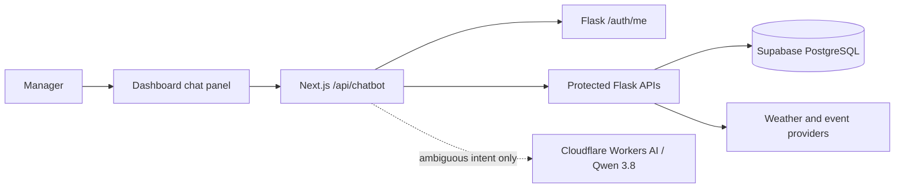
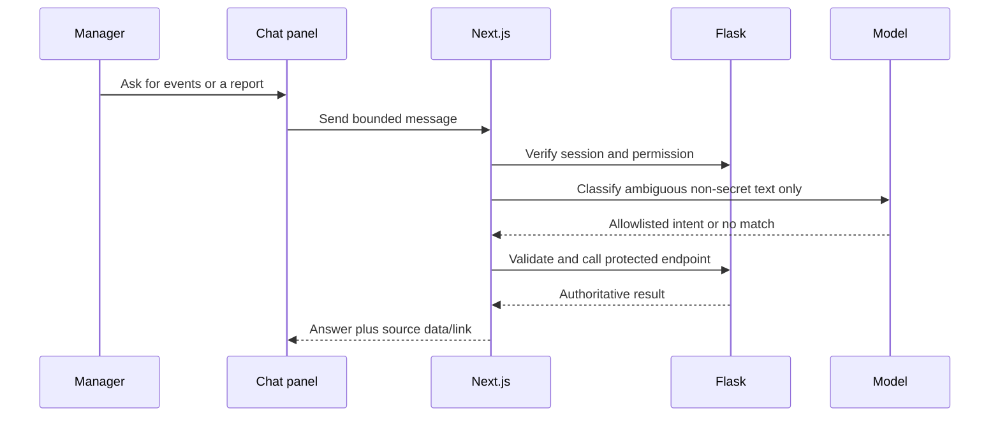

# RFS chatbot architecture design

Status: deployed technical boundary with incomplete acceptance. #54 and #55 remain Partial after [PR #7](https://github.com/vale2015/Dissertation/pull/7) and later UI releases; live model inference, staff-action safety, and role-based end-to-end journeys remain open in the [tracker](IMPROVEMENT_TRACKER.md). The [PRD](PRD.md) owns the current product contract. The current launcher is below the left menu and opens a left dock; older top-bar/bottom-right proposals below are historical where noted.

## 1. Product intent and release boundary

RFS lets a restaurant manager type requests for weather, nearby events, fresh and past management reports, report save/download, and current Staff Management actions. The chatbot is another interface to the same protected capabilities, not a second source of truth. Its launcher now sits below the left sidebar menu. Local Events and Past Reports are chat workflows; Staff Management returned to the sidebar under the approved redesign and also remains available inside chat. Reports is view-only. Existing direct routes remain as recovery paths.

The first published branch had an inert **skeleton** (#55). Later releases added the typed composer, protected read flows, an embedded staff workspace, and suggested prompts that prefill without sending. These are deployed, but #54–55 are not fully verified. The chat does not write to Supabase directly.

## 2. Architecture decision

The existing application already has Next.js route handlers, an installed AI SDK, an HttpOnly session cookie, a Flask API with role/permission checks, and Supabase PostgreSQL behind Flask. Keep those boundaries. A new Flask-hosted Claude/OpenAI adapter would duplicate AI plumbing and require a second provider integration without adding product value.

- **Browser:** renders the panel and source-linked results. It never receives the session JWT, model credential, or database connection.
- **Next.js route:** reads the HttpOnly cookie, verifies identity with Flask, checks manager access, validates each request, and orchestrates bounded model classification and allowlisted backend requests. It does not trust a role, tool name, or confirmation flag supplied by the browser.
- **Flask:** remains authoritative for permissions, business validation, staff audits, report calculations, weather, and events. Every future tool request must pass through protected Flask endpoints or the same service boundary.
- **Supabase:** remains behind Flask. The skeleton adds no table or migration.

The user selected Cloudflare Workers AI and its documented `@cf/qwen/qwen3.8-27b` model to avoid a funded account for the prototype. The Next.js server uses the installed AI SDK OpenAI-compatible provider with `CLOUDFLARE_ACCOUNT_ID` and `CLOUDFLARE_API_TOKEN` configured privately in Vercel Preview and Production; their values and live inference have not been verified in this documentation pass. The model only classifies ambiguous text into allowlisted intents; it never receives backend records or executes tools. Direct, explicit requests work without a model. No separate agent framework, durable workflow, WebSocket, or Redis is needed for read-only work; durable idempotency is still required before staff writes meet the final acceptance criteria. See [Cloudflare model](https://developers.cloudflare.com/workers-ai/models/qwen3.8-27b/), [compatible endpoint](https://developers.cloudflare.com/workers-ai/configuration/open-ai-compatibility/), and [pricing](https://developers.cloudflare.com/workers-ai/platform/pricing/).

## 3. Current deployed chat contract (#54–55)

- GET /api/chatbot: requires a valid manager session verified against Flask /auth/me; fetches protected weather without a model call, and returns no-store status plus a weather or unavailable message.
- POST /api/chatbot: checks origin, manager session, bounded JSON message, optional validated report context, and a local intent parser. Ambiguous non-sensitive requests may use Cloudflare for intent classification. It calls only fixed protected Flask routes or returns a staff-workspace instruction; model output is never an authorization decision.
- The manager-only launcher appears below the left sidebar navigation. The panel has an enabled typed composer, short capability greeting, suggested prompts that only prefill, and in-chat results or secure staff forms. On desktop it docks beside the sidebar and moves page content; Escape and Close restore focus to the launcher.

An unavailable backend must fail closed for requests. Weather failure does not disable the rest of the chat; model unavailability falls back to explicit typed commands.

## 4. Capability contract and remaining gaps (#54)

| Capability | Existing source | Permission | Interaction |
| --- | --- | --- | --- |
| Weather on open | GET /api/weather/ | view_forecasts | Deterministic card, fetched when chat opens; no model call needed. Show observation time and stale/unavailable state. |
| Local events | GET /api/events/?start_date=&end_date= | view_forecasts | Bound and validate dates; show provider, date, source link, and unavailable state. |
| Fresh and saved management reports | GET /api/reports/management?selected_date=&days_ahead=, report-history endpoints, and protected downloads | view_reports | Generate, summarize exact source figures, save, list, view, and download in chat without page navigation. The Reports sidebar entry is a read-only view. |
| Staff search/detail | GET /api/staff/ and GET /api/staff/{id} | manage_staff_accounts | Return minimum needed fields; do not send raw records or secret links to the model. |
| Staff registration/edit/status/reset | Existing POST/PATCH staff routes | manage_staff_accounts | Current secure workspace uses review/confirmation and protected routes. Durable idempotent execution remains open; never pass passwords or activation/reset links through model context. |

The first draft's clock-in, clock-out, mark-sick, schedule, and reassign-role actions are **not** current RFS Staff Management endpoints. They are excluded rather than invented. The current app supports registration, edit, status changes (suspend/deactivate/reactivate), and reset-link issuance.

Tool visibility to the model is a usability filter, **not** authorization. Recheck the user's current permissions in the server executor and in Flask for every call. The model's instructions are never a grant of access.

## 5. Read and write flows

The current staff workspace uses secure forms and explicit review/confirmation. The model does **not** propose or execute staff writes. To satisfy the remaining reliability acceptance criterion, a future confirmed-action flow needs a short-lived server-side action tied to the user, target, expected before-state, and a stable idempotency key. The UI should show the exact person and before/after values; a second request would reload the action and permissions, verify expected state, perform one protected Flask operation, and return the original result on retry. This durable step is not implemented yet.

No write action is safe with only an in-memory pending card or a browser-generated key. The confirmed-action store, uniqueness constraint, and audit trail require a separate migration and tests before staff write tools are enabled.

## 6. UI/UX design

The panel is a non-modal dashboard companion launched below the left sidebar menu. On desktop it docks to the left of page content; on smaller screens it stays in normal flow. The approved mockup includes suggested prompts, but they only prefill the typed composer. Keyboard users can open it with Enter/Space, close with Escape or the labelled button, and return focus to the launcher. Buttons and inputs need visible focus states; status and errors need appropriate live regions. Reduced-motion preferences should be respected as animation is added.

Future conversation design should distinguish user messages, AI interpretation, verified source results, and proposed actions. Weather should appear automatically on open, not wait for a greeting. Reports and events need timestamps and links to the original screen/source. Every proposed staff change needs a separate confirmation card; never hide confirmation inside ordinary prose. Errors should name what failed and provide a safe retry without duplicating writes.

The panel must state when capabilities are unavailable. It must not impersonate a working AI assistant before model and tool tests pass.

## 7. Privacy, reliability, and evaluation

- Keep secrets, JWTs, passwords, activation/reset links, and raw staff records out of model prompts, logs, and browser-readable state.
- Limit user input length, date ranges, tool steps, runtime, and spend. Add per-user rate limits and cost alerts before enabling model calls.
- Treat model text and retrieved provider content as untrusted; validate structured tool arguments and render text safely.
- Log minimal evaluation metadata (user pseudonym or internal ID, intent category, tool name, authorization outcome, latency, model usage, error code) with retention. Do not store full message text or tool arguments by default. An interaction table is optional and requires a privacy decision and migration.
- Do not keep server conversation or pending-action state in process memory. For an initial read-only chat, a bounded client-side transcript can be ephemeral; server-validated pending writes must be durable.
- Evaluate intent routing, tool selection, source fidelity, refusal of unauthorized actions, duplicate-confirm prevention, accessibility, and recovery paths with scripted cases before release.

The preliminary pronouns-column proposal is **deferred**. The assistant can address the manager directly and use neutral language without adding sensitive profile data. If users later request an optional self-reported preference, design consent, editing, deletion, and retention separately; never infer pronouns from names or use them for authorization. An avatar must not be inferred from pronouns.

## 8. Delivery and acceptance

1. **#55 deployed shell:** manager-only left-sidebar launcher/dock, authenticated GET and typed POST, automatic weather, suggested prompt prefill, responsive and keyboard design. Finish authenticated role and browser verification.
2. **#54 deployed capabilities:** bounded event lookup and fresh/saved report generation, save and download in chat; embedded protected staff workspace. Model classifies only ambiguous requests; source figures remain deterministic. Finish live model, privacy, usage-limit, and end-to-end verification.
3. **#54 staff-write reliability:** add durable idempotency, audit, and permission tests for registration, edit, status, and reset before claiming complete safety.
4. **Release quality:** authenticated manager and restricted-role browser journeys, end-to-end success/failure tests, runtime monitoring, and rollback evidence. Git push, migration, and Vercel READY are separate milestones.

For #55, “Done” requires the current active panel to open/close by mouse and keyboard on representative dashboard pages, deny signed-out and non-manager access, handle typed GET/POST journeys and errors, and pass focused tests plus a clean build. The old inert-skeleton criterion is historical; a deployment alone does not satisfy this.

## 9. Decisions still needed before #54

- Resolved: chat report generation includes save, history, view, and PDF/CSV download without navigating to another page.
- For staff registration, should chat use the current active-account/password form or a future invitation flow?
- Which minimal staff fields may enter model context, if any, and what conversation retention is acceptable?
- Resolved provider/model for the prototype: Cloudflare Workers AI/Qwen 3.8 on the free account. Correctly named credentials are configured for Preview and Production, but their values and live inference have not been verified. The Production build was released before free-allowance, privacy/usage-limit, and evaluation checks; complete those checks before marking the chatbot Done or widening use.
