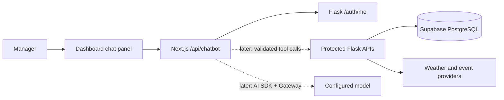
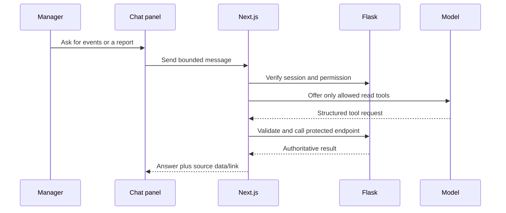

# RFS chatbot architecture design

Status: engineering-reviewed design. The #55 skeleton is being implemented locally; #54 business capabilities remain open. The [improvement tracker](IMPROVEMENT_TRACKER.md) owns delivery status. This document supersedes the preliminary tool schema and deployment suggestions in the first draft.

## 1. Product intent and release boundary

RFS should let a restaurant manager ask for weather, nearby events, and a fresh management report, then eventually complete existing Staff Management actions through a guided conversation. The chatbot is another interface to the same protected capabilities, not a second source of truth. The sidebar and existing screens stay available.

The first release is deliberately a **skeleton** (#55): one responsive launcher and panel in the shared dashboard layout, manager-only access, a protected availability endpoint, clear loading/error/empty states, and disabled message submission. It does **not** call a model, read business data, execute tools, or write to Supabase. The later #54 release adds capabilities one by one.

## 2. Architecture decision

The existing application already has Next.js route handlers, an installed AI SDK, an HttpOnly session cookie, a Flask API with role/permission checks, and Supabase PostgreSQL behind Flask. Keep those boundaries. A new Flask-hosted Claude/OpenAI adapter would duplicate AI plumbing and require a second provider integration without adding product value.

- **Browser:** renders the panel and source-linked results. It never receives the session JWT, model credential, or database connection.
- **Next.js route:** reads the HttpOnly cookie, verifies identity with Flask, checks manager access, validates each request, and will eventually orchestrate model/tool calls using the installed AI SDK. It does not trust a role, tool name, or confirmation flag supplied by the browser.
- **Flask:** remains authoritative for permissions, business validation, staff audits, report calculations, weather, and events. Every future tool request must pass through protected Flask endpoints or the same service boundary.
- **Supabase:** remains behind Flask. The skeleton adds no table or migration.

The model/provider will be selected by reviewed server configuration through the AI Gateway. Do not hard-code a remembered model ID or call provider APIs directly. No separate agent framework, durable workflow, WebSocket, or Redis is required for this bounded interactive first release.

## 3. Current skeleton contract (#55)

- GET /api/chatbot: requires a valid manager session verified against Flask /auth/me; returns phase=skeleton, conversation_enabled=false, business_tools_enabled=false. Responses are no-store.
- POST /api/chatbot: checks origin and manager session, then returns 501. It does not parse the message body, call a model, or dispatch a business tool.
- The launcher appears only to managers inside the shared dashboard layout. The panel labels itself as a preview, offers links to existing permitted screens, and has a disabled composer.
- Opening the panel checks endpoint availability; a failed check shows a retryable error. Escape and the close control close the non-modal dialog and restore focus to the launcher.

This is an honest foundation rather than a simulated AI conversation. An unavailable backend must fail closed, not display a working chat.

## 4. Future capability contract (#54)

| Capability | Existing source | Permission | Interaction |
| --- | --- | --- | --- |
| Weather on open | GET /api/weather/ | view_forecasts | Deterministic card, fetched when chat opens; no model call needed. Show observation time and stale/unavailable state. |
| Local events | GET /api/events/?start_date=&end_date= | view_forecasts | Bound and validate dates; show provider, date, source link, and unavailable state. |
| Fresh management report | GET /api/reports/management?selected_date=&days_ahead= | view_reports | Generate on demand from the existing calculation, summarize exact source figures, and link to the full report screen. Saving/downloading in chat is a separate decision. |
| Staff search/detail | GET /api/staff/ and GET /api/staff/{id} | manage_staff_accounts | Return minimum needed fields; do not send raw records or secret links to the model. |
| Staff registration/edit/status/reset | Existing POST/PATCH staff routes | manage_staff_accounts | Require a reviewed proposal card, explicit confirmation, fresh authorization, and idempotent execution. Never pass passwords or activation/reset links through model context. |

The first draft's clock-in, clock-out, mark-sick, schedule, and reassign-role actions are **not** current RFS Staff Management endpoints. They are excluded rather than invented. The current app supports registration, edit, status changes (suspend/deactivate/reactivate), and reset-link issuance.

Tool visibility to the model is a usability filter, **not** authorization. Recheck the user's current permissions in the server executor and in Flask for every call. The model's instructions are never a grant of access.

## 5. Read and write flows

For a staff write, the model may only **propose** a typed action. The server creates a short-lived pending action tied to the user, target, expected before-state, and a stable idempotency key. The UI shows the exact person and before/after values. Confirmation is a second, explicit request; the server reloads the action and permissions, verifies the expected state, performs one existing Flask operation, and records the outcome. Cancel/expiry performs no write. Network retries must return the original result, not repeat the mutation.

No write action is safe with only an in-memory pending card or a browser-generated key. The confirmed-action store, uniqueness constraint, and audit trail require a separate migration and tests before staff write tools are enabled.

## 6. UI/UX design

The panel is a non-modal dashboard companion: a persistent bottom-right launcher, clear title and preview state, readable source cards, and an unchanged sidebar. On mobile it fits within the viewport without covering the close control. Keyboard users can open it with Enter/Space, close with Escape or the labelled button, and return focus to the launcher. Links and buttons have visible focus states; status and errors use appropriate live regions. Reduced-motion preferences should be respected as animation is added.

Future conversation design should distinguish user messages, AI interpretation, verified source results, and proposed actions. Weather should appear automatically on open, not wait for a greeting. Reports and events need timestamps and links to the original screen/source. Every proposed staff change needs a separate confirmation card; never hide confirmation inside ordinary prose. Errors should name what failed and provide a safe retry without duplicating writes.

The panel must state when capabilities are unavailable. It must not impersonate a working AI assistant before model and tool tests pass.

## 7. Privacy, reliability, and evaluation

- Keep secrets, JWTs, passwords, activation/reset links, and raw staff records out of model prompts, logs, and browser-readable state.
- Limit user input length, date ranges, tool steps, runtime, and spend. Add per-user rate limits and cost alerts before enabling model calls.
- Treat model text and retrieved provider content as untrusted; validate structured tool arguments and render text safely.
- Log minimal evaluation metadata (user pseudonym or internal ID, intent category, tool name, authorization outcome, latency, model usage, error code) with retention. Do not store full message text or tool arguments by default. An interaction table is optional and requires a privacy decision and migration.
- Do not keep server conversation or pending-action state in process memory. For an initial read-only chat, a bounded client-side transcript can be ephemeral; server-validated pending writes must be durable.
- Evaluate intent routing, tool selection, source fidelity, refusal of unauthorized actions, duplicate-confirm prevention, accessibility, and recovery paths with scripted cases before release.

The preliminary pronouns-column proposal is **deferred**. The assistant can address the manager directly and use neutral language without adding sensitive profile data. If users later request an optional self-reported preference, design consent, editing, deletion, and retention separately; never infer pronouns from names or use them for authorization. An avatar must not be inferred from pronouns.

## 8. Delivery and acceptance

1. **#55 skeleton (current slice):** manager-only launcher/panel, authenticated GET and inert POST, responsive and keyboard design, error handling, unit/build/access tests. No AI request, tool call, or database change.
2. **#54 read-only:** weather on open; then bounded event lookup and fresh report generation with source cards. Add model only after privacy, model choice, rate/cost limits, and evaluation tests are agreed.
3. **#54 staff reads and writes:** staff lookup first; then registration, edit, status, and reset flows one at a time with durable confirmation, idempotency, audit, and permission tests.
4. **Release quality:** authenticated manager and restricted-role browser journeys, end-to-end success/failure tests, runtime monitoring, and rollback evidence. Git push, migration, and Vercel READY are separate milestones.

For #55, “Done” requires the panel to open/close by mouse and keyboard on representative dashboard pages, deny signed-out and non-manager access, leave POST and business actions inert, and pass focused tests plus a clean build. A deployment alone does not satisfy this.

## 9. Decisions still needed before #54

- Does chat report generation only show a report with a link, or must it save/download PDF and CSV inside chat?
- For staff registration, should chat use the current active-account/password form or a future invitation flow?
- Which minimal staff fields may enter model context, if any, and what conversation retention is acceptable?
- Which Gateway model, cost ceiling, and evaluation threshold justify enabling model calls?
