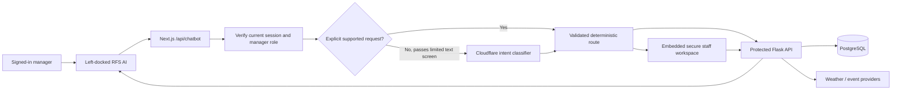
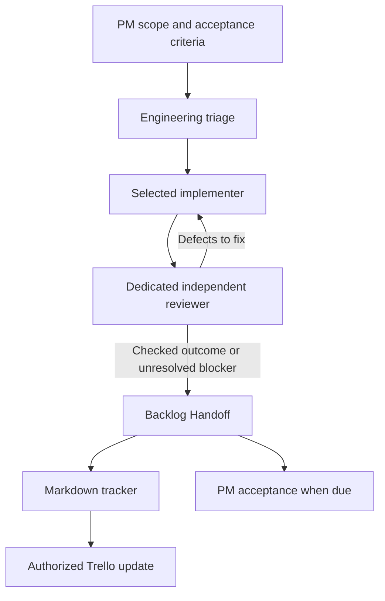

# RFS agentic capabilities and delivery framework

**Current-state guide — 10 November 2026.** This document covers two different kinds of “agent”: the manager-facing RFS AI assistant in the product, and the PM-led specialist workflow used to develop the product. They are not one autonomous system. The [PRD](../product/PRD.md) owns product requirements; the [tracker](../product/IMPROVEMENT_TRACKER.md) owns completion and release status. The [architecture guide](../architecture/ARCHITECTURE.md) owns system-wide component boundaries.

## 1. Manager-facing RFS AI

RFS AI is a **manager-only, typed assistant** launched below the left navigation. On desktop it opens as a 400 px dock beside the 240 px sidebar, shifting the dashboard instead of covering it; on smaller screens it appears in normal flow. It greets the manager, retrieves weather when opened, and offers suggested requests that **fill the composer but do not send**. The manager must submit a request.

| Request | Current behaviour | Boundary |
| --- | --- | --- |
| Weather | Fetches the restaurant weather on open and on request. | Protected Flask weather API; no model required. |
| Local events | Retrieves date-bounded nearby events and source context. | Protected event API; provider results can be unavailable. This is not an all-London event guarantee. |
| Bookings and forecasts | Summarises today's bookings, reservation demand, and staffing recommendations. | Read-only, source-derived answers; predictions are not completed bookings or a rota. |
| Reports | Generates, saves, finds, views, and downloads management reports in chat. | Protected report APIs; the Reports page itself only lists and displays saved snapshots. |
| Staff Management | Opens an embedded secure workspace for search, detail, registration, editing, status changes, and reset-link actions. | Existing protected forms and explicit confirmation perform writes; the model never executes a staff mutation. |

Explicit supported requests are routed by deterministic code. For an ambiguous request, the Next.js server may send the **user-typed message** to Cloudflare Workers AI (`@cf/qwen/qwen3.8-27b`) for classification into an allowlisted intent. It screens obvious identifiers/secrets such as `@`, password, token, secret, and reset-link terms, but that filter is **not a complete personal-data detector**; a user could still type sensitive information in other forms. The model does not receive Flask results, raw staff records from the backend, or an executable tool. Its output is not an authorization decision. A privacy review and stronger input controls remain open. Without model credentials or during a model failure, direct requests can still work; ambiguity receives a safe fallback.

The chat route validates origin, JSON size, message/context, session, and manager access before a bounded request. Flask remains the authority for permissions and business rules. Staff write reliability is **not complete**: durable idempotency, privacy/usage limits, live model inference, and authenticated manager/restricted-role end-to-end checks are open under [#54–55](../product/IMPROVEMENT_TRACKER.md). The separate saved-report AI-explanation pilot [#52](../chatbot/AI_REPORT_EXPLANATIONS.md) is feature-gated off by default, its current production enablement has not been rechecked, and it is **not** part of the chatbot.

**Next approved workflow, not live:** registration and editing should become multi-turn, typed journeys with secure password capture and exact-target confirmation. Only after they and the existing staff actions pass release checks should Staff Management disappear from the sidebar. The model remains an optional intent classifier, never the write executor. See the [focused workflow and diagram](../chatbot/STAFF_MANAGEMENT_CHAT_WORKFLOW.md).

## 2. PM-led specialist team

The user is the Product Manager (PM) and owns scope, priority, and final acceptance. The coordinator starts with `feature-triage`, picks a pair from the [role registry](../../.agents/team.json), and explicitly invokes one specialist at a time in a single active workflow. The [task packet](../../.agents/task-packet.md) generates a fresh briefing of at most 500 words. The reviewer starts after the implementer's turn ends and receives a handoff of at most 200 words.

| Specialist | Implementer | Dedicated reviewer | Review focus |
| --- | --- | --- | --- |
| Frontend | `RFS-FE` | `RFS-FE-REVIEW` | Next.js behavior, client state, responsive layout, and keyboard access |
| Backend | `RFS-BE` | `RFS-BE-REVIEW` | Flask contracts, validation, permissions, and regressions |
| UI/UX design | `RFS-UX` | `RFS-UX-REVIEW` | Manager workflows, responsive design, and accessibility |
| Security | `RFS-SEC` | `RFS-SEC-REVIEW` | Authorization, least privilege, privacy, and sensitive actions |
| Database | `RFS-DB` | `RFS-DB-REVIEW` | Schema compatibility, migrations, data integrity, and access |
| AI/chatbot | `RFS-BOT` | `RFS-BOT-REVIEW` | Routing, grounding, fallback behavior, and safe tools |
| Automation | `RFS-AUTO` | `RFS-AUTO-REVIEW` | Trigger scope, retries, repeat execution, and recovery |

QUICK uses focused independent review, STANDARD adds relevant regression checks, and FULL adds the risk review selected during triage. The reviewer returns verifiable findings without editing implementation. Two unsuccessful fix/retest cycles end rework on that defect.

Backlog Handoff (`RFS-BACKLOG`) receives review evidence, updates the authoritative Markdown tracker, then performs authorized card moves and comments on the [Trello board](TRELLO_BOARD_WORKFLOW.md). It preserves existing domain and delivery-tier labels and records outstanding PM acceptance. The PM retains authority for releases and production-data changes. The coordinator manages this sequence at each handoff. Runtime activation depends on the client.

**Current evidence:** the skills and workflow are installed and their original configuration was independently reviewed. The #63 Staffing Forecast work exercised the sequence, but tracker [#58](../product/IMPROVEMENT_TRACKER.md) remains Partial until explicit PM acceptance and remaining validation are recorded. On 7 November 2026 the PM re-enabled Trello and the 62 non-deferred tracker items were mirrored with descriptions and acceptance criteria. See the [workflow history](RFS_AI_TEAM_WORKFLOW.md), [board rules](TRELLO_BOARD_WORKFLOW.md), and [chatbot technical note](../chatbot/RFS%20Chatbot%20Architecture%20Design.md).

## 3. Rules shared by both kinds of agent

The project delivery agent also has a [research knowledge-base entry point](../knowledge/README.md). Its six-publisher source registry, initialized durable records, stable HTML review shell, and Issue-triggered publisher are installed on `main`; `AGENTS.md` directs future project work to them. This is **not** a capability of the restaurant-facing chatbot. The publisher accepts research Issues only from the verified `vale2015` account and stages only generated research outputs. That workflow-level limit does not narrow the owner's other GitHub permissions. A real scan, Issue/Actions publication, browser check, weekly-task prompt/run, and fresh-context recovery remain unverified under [#64](../product/IMPROVEMENT_TRACKER.md). Research can inform a PM decision, but cannot approve or start product work on its own; the [runbook](../knowledge/AUTOMATION_RUNBOOK.md) specifies the current boundary.

- No model output or specialist role grants permissions. The authenticated backend and PM decision respectively remain authoritative.
- Keep user/customer/staff secrets out of prompts, logs, reports, and browser variables.
- Show source data, dates, estimates, and unavailable states honestly; never invent event coverage, report totals, or forecast accuracy.
- Require explicit human review for sensitive writes and record actual test evidence before calling work Done.
