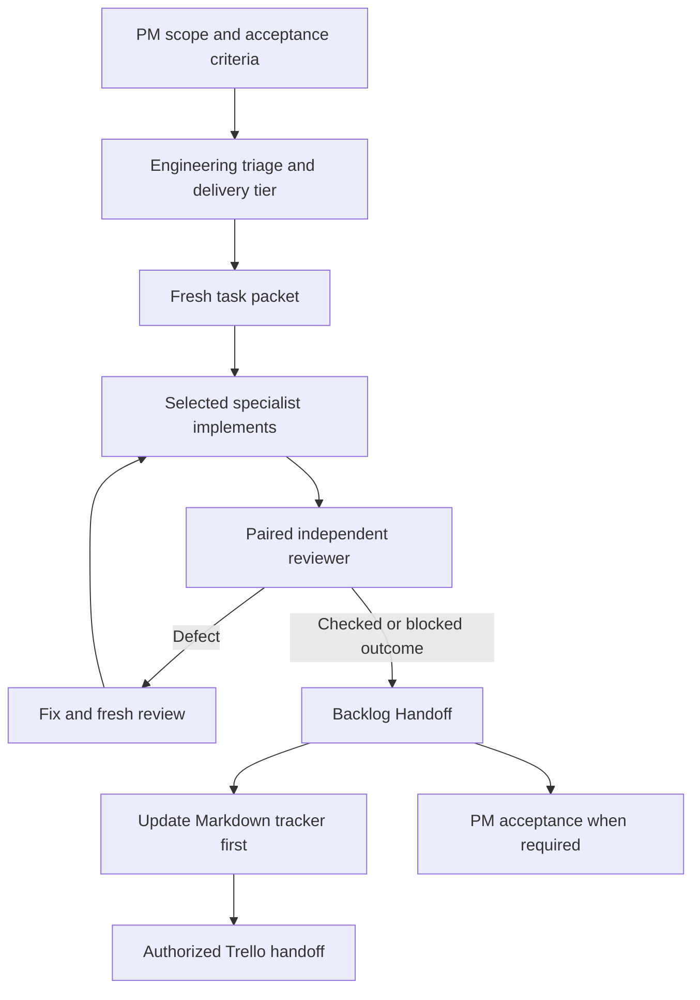

# RFS agentic development architecture

Updated 23 November 2026 · delivery workflow #58 and token-efficiency work #68

The development team consists of seven specialists, seven paired independent reviewers and Backlog Handoff. The coordinator runs one workflow and one specialist at a time. The PM owns scope, priority and final acceptance. These are project instructions and explicit invocations; they do not install continuously running agents.

## Delivery flow

The implementer ends before the reviewer starts. After two unsuccessful fix/retest cycles on the same defect, record the blocker. Backlog Handoff receives the checked or blocked result and records the actual outcome; a card move does not establish completion.

## Specialist pairs and routing

| Specialist | Role / workflow | Dedicated reviewer | Domain label | Implementation model / effort | Review model / effort |
| --- | --- | --- | --- | --- | --- |
| Frontend engineer | `RFS-FE` / `WF-FE` | `RFS-FE-REVIEW` | Front end Dev | gpt-6.2-sol / medium | gpt-6.1-sol / high |
| Backend engineer | `RFS-BE` / `WF-BE` | `RFS-BE-REVIEW` | Backend Dev | gpt-6.2-sol / medium | gpt-6.1-sol / high |
| UI/UX designer | `RFS-UX` / `WF-UX` | `RFS-UX-REVIEW` | Front end Dev | gpt-6.2-astra / high | gpt-6.1-terra / high |
| Security engineer | `RFS-SEC` / `WF-SEC` | `RFS-SEC-REVIEW` | Security Dev | gpt-6.2-astra / high | gpt-6.2-astra / high |
| Database engineer | `RFS-DB` / `WF-DB` | `RFS-DB-REVIEW` | Db Dev | gpt-6.2-sol / medium | gpt-6.1-sol / high |
| AI/chatbot engineer | `RFS-BOT` / `WF-BOT` | `RFS-BOT-REVIEW` | Bot Dev | gpt-6.2-sol / medium | gpt-6.1-sol / high |
| Automation engineer | `RFS-AUTO` / `WF-AUTO` | `RFS-AUTO-REVIEW` | Automation Dev | gpt-6.2-sol / medium | gpt-6.1-sol / high |

UI/UX creates mockups and design guidance for frontend implementation. Each engineer owns only its approved domain. Security and database changes retain their existing permission and production-write limits; AI output never grants permission. Cross-domain work invokes only the relevant pairs, sequentially.

Backlog Handoff is `RFS-BACKLOG` / `WF-BACKLOG`, profile `rfs_backlog_handoff`. Engineering triage selects the delivery tier. The token-only analyst reviews sanitized usage evidence; it does not implement features or approve releases.

## Compact context and independent review

- `tools/agent_workflow/packet.mjs` emits the selected model/effort and `fork_turns: "none"`, with a briefing capped at 500 words. It references relevant files instead of embedding histories or logs.
- Every implementation/review handoff is capped at 200 words and names the actual preceding agent identity, changed paths, checks, gaps and next action.
- QUICK uses focused independent review. STANDARD adds relevant regressions. FULL adds the necessary domain risk review. Self-checks are never independent approval.
- The coordinator manages execution order and verifies client/model availability. Configuration is not proof of automatic profile activation across clients.

## Trello workflow

[Open the RFS BACKLOG TASKS board](https://trello.com/b/vF796eiJ/rfs-backlog-tasks).

| Tracker state | Trello list | Meaning |
| --- | --- | --- |
| Proposed | Open | Unreviewed knowledge-base proposal. |
| Open | READY | PM-approved work that has not been picked up. |
| Partial | IN PROGRESS | Implementation or verification is incomplete. |
| Verify release | IN REVIEW | Release checks or final acceptance remain. |
| Done | DONE | Required checks and applicable PM acceptance are complete. |
| Deferred | No card | Keep deferred work off the active board. |

A knowledge-base proposal keeps its origin throughout its lifecycle. Advancing beyond Proposed requires `pmReviewed: true` and a recorded `pmDecisionRef`; the coordinator must verify that the actual PM decision supports the transition. A boolean or reference by itself does not authorize work. The research publisher and schedule are unchanged.

Every numbered task has its relevant domain labels and exactly one of QUICK, STANDARD or FULL. Label updates add missing IDs only; moves preserve labels. The current 68-task classification is 1 QUICK, 34 STANDARD and 33 FULL, with 231 assignments. Open is ready for new proposals and currently empty; existing approved tasks retain their original columns.

## Epic grouping cards

The EPICS list contains six standard grouping cards. Each links to all matching numbered tasks, with delivery-tier tags. Cross-domain tasks appear in more than one group; there are 163 memberships across 68 unique tasks. Grouping cards have their domain and FULL labels and do not replace the tasks' workflow states.

| Epic | Linked tasks | Domain |
| --- | ---: | --- |
| [EPIC — Front end Development](https://trello.com/c/oytNsdXb/69-epic-front-end-development) | 33 | Front end Dev |
| [EPIC — Backend Development](https://trello.com/c/QJXQaSGK/70-epic-backend-development) | 47 | Backend Dev |
| [EPIC — Db Dev](https://trello.com/c/9NXyW3er/71-epic-db-dev) | 25 | Db Dev |
| [EPIC — Security Dev](https://trello.com/c/bjg1Mopl/72-epic-security-dev) | 30 | Security Dev |
| [EPIC — Bot Dev](https://trello.com/c/BVTuqmr2/73-epic-bot-dev) | 9 | Bot Dev |
| [EPIC — Automation Dev](https://trello.com/c/6bJeHWAl/74-epic-automation-dev) | 19 | Automation Dev |

These are standard index cards, not a native parent/child issue hierarchy. The current [official card-type catalog](https://support.atlassian.com/trello/docs/card-types/) does not list an Epic type; [mirroring documentation](https://support.atlassian.com/trello/docs/mirroring-cards/) describes paid functionality. This implementation enables no add-on, paid plan or background synchronization. At authorized handoffs, refresh only the generated Linked tasks section and preserve manual Notes.

## Where the files live

| Path | Purpose |
| --- | --- |
| `.agents/team.json` | Role pairs, references, ownership labels, profile and instruction paths. |
| `.codex/agents/` | Separate TOML definitions for specialists, reviewers and Backlog Handoff. |
| `.agents/model-routing.json` | Model/effort selection and one-workflow/one-specialist policy. |
| `.agents/task-packet.md` | Packet schema and sequential handoff procedure. |
| `tools/agent_workflow/packet.mjs` | Bounded, sanitized invocation generation. |
| `tools/agent_workflow/labels.mjs` | Additive label planning and conflict checks. |
| `tools/agent_workflow/status.mjs` | Proposal/status routing and PM-decision evidence gate. |
| `tools/agent_workflow/epics.mjs` | Deterministic six-group specification generation. |
| `.agents/skills/backlog-handoff/SKILL.md` | Tracker-first outcome, ticket and acceptance handoff. |
| `docs/agents/TRELLO_BOARD_WORKFLOW.md` | Live board procedure, labels, routing and grouping maintenance. |
| `docs/agents/TRELLO_LABEL_PLAN.json` | Applied, independently verified classification of 68 numbered tasks. |
| `docs/agents/TRELLO_EPIC_GROUPS.json` | Six grouping specs and their live card identities. |
| `docs/agents/RFS_AGENTIC_IMPROVEMENTS_2026-11-22.md` | Ordered evidence, access history and remaining acceptance. |

## Verification and publication

All five scoped implementation steps passed independent verification. Source checks covered seven pairs, Backlog Handoff, 20 TOMLs and 15 registered mappings. The 12 packet tests and independent URI privacy cases passed after correction. Status/label review passed 13 focused tests and 15 extra cases. Epic review passed all 29 workflow tests and 21 negative cases. Fresh live readback verified all 74 cards: 68 unchanged numbered tasks, six grouping cards, the empty first Open list and all expected labels/links. Manual Notes retention was checked in instructions, not through live note edits.

Trello implementation is complete and independently verified. The PM approved installing ChatGPT Codex Connector for only `vale2015/Dissertation` on 23 November 2026. Installation `184939334` was read back with that single selected repository, and a branch write succeeded. The reviewed source was published on GitHub main as [952af98](https://github.com/vale2015/Dissertation/commit/952af986d11b75423b709201be264fc27144a153); tracker and handover checkpoints followed as `8b30ed3` and `8db8291`. A fresh Git fetch verified all 54 changed files byte for byte against the intended workspace. The original historical bodies of the tracker and handover are preserved exactly, with only concise current entries inserted. The earlier integration-access blocker is resolved.

Overall #58 PM acceptance remains open. #68 remains Partial because counters/comparable savings and automatic activation remain unverified. Missing usage is unknown, not zero. No Windows checkout update, restaurant application/database change or manual deployment is included. Git publication is verified separately from any automatically triggered Vercel build.
