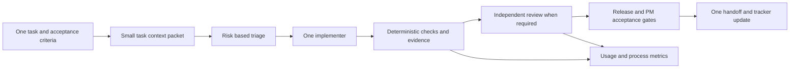

# RFS token efficiency and workflow architecture plan
19 November 2026 · Architecture/research proposal · Backlog #68

**27 November runtime note (#72):** this plan was written for the Codex runtime. The workflow now runs on Claude Code, and token capture reads Claude Code transcripts; see the [token analyst runbook](TOKEN_USAGE_ANALYST.md). The recommendations still apply, but Codex-specific usage and caching statements are historical.

**20 November implementation checkpoint:** PM selected #68 and requested task-specific models, a dedicated token analyst and per-workflow reports. Local response counters are now available; see [the implementation runbook](TOKEN_USAGE_ANALYST.md). The historical research below remains evidence, not proof of installed integrations or measured savings. All edits now take place directly in the PM’s VS Code checkout.

**Recommendation:** optimize the existing Codex + GitHub + Trello workflow first. Pilot Linear only if coordination remains expensive; pilot n8n only for proven cross-service automation. Add token observability before attributing savings to either. Chatbot #65 → #66 → #67 retains first priority. This report is planning/research, not an installed tool, enabled automation or measured saving.

## What was inspected and what remains unknown

Repository evidence: AGENTS.md, specialist instructions, delivery workflow, tracker, handover, backend/migration/research CI, chatbot route and model adapter. The tracker is about 118 KB, handover 21 KB and AGENTS.md 8 KB at inspection; these are file sizes, not measured prompt tokens. Large history and repeated full-document/tool output create avoidable context risk. Existing QUICK/STANDARD/FULL paths and the two-cycle stop rule are good foundations.

Backend CI already has path filters and dependency caching; research publication already has concurrency control. Backend/migration workflows trigger on both push and pull request; duplicate runs are a risk to measure, not a proven count of wasted executions. Do not rebuild these protections from scratch.

No historical per-task Codex usage export, cached-token totals, subscription utilization or provider bill was available. Exact current spend and savings are unknown. Codex subscription usage, API token charges, Cloudflare neurons, CI minutes and paid automation executions are separate measures.

The RFS model adapter currently classifies a fixed task vocabulary into allowed intents. It does not produce general free-form answers. It already uses deterministic routing first, a 256-output-token ceiling, no automatic model retry and a ten-second timeout. General conversation would be new scope, not something this optimization plan silently adds.

## Target workflow

The model handles ambiguity, design and diagnosis. Scripts/CI collect status, validate formats, run checks and render evidence. No additional agent is required to copy a status between systems.

## Ordered implementation proposal

### 1. Establish a baseline and separate cost centres
Capture the next ten comparable completed task slices, tagged QUICK/STANDARD/FULL. Use existing records for an initial baseline only where source and counts are trustworthy. Record input/output/reasoning/cached usage when the product exposes it; mark unavailable fields null, never zero. Otherwise record clearly labelled proxies: bytes retrieved, tool calls, handoffs, repeat tests and elapsed active/wait time.

For the application, capture provider-reported usage, model/version, duration, route outcome and error category without prompts, credentials or staff data. Capture failed attempts too, with usage marked unknown if not returned. Reconcile token estimates with Cloudflare's billing units and actual plan rather than assuming a universal per-token price.

### 2. Introduce a compact task packet and current-state index
Propose a versioned machine-readable record per task containing: ID, objective, acceptance checks, scope/files, exact source SHA, touched dependencies, environment/build IDs, evidence links, blocker, next action and data-mutation limits. Initial target: at most 1,500 input tokens of task-specific briefing, excluding necessary code/diffs. This is a design target, not a configured Codex limit.

Keep a short current-state index and move dated history to linked archives while preserving IDs and audit evidence. The canonical tracker remains authoritative until a separate PM-approved change. Agents read the index, task section and relevant skill; fetch historical details on demand. Propose instruction changes explicitly before replacing today's required startup reads.

### 3. Reduce repeated coordination
Keep one active implementer and a separate reviewer when risk requires it. QUICK remains suitable for low-risk reversible docs/configuration; STANDARD for meaningful implementation; FULL adds only relevant security/AI/UX reviews. A formatting-only update should not run the entire team.

Pass only the task packet and necessary diff to the next role. Retain 80–150-word Result / Checked / Next / Evidence ticket comments; keep long logs in evidence artifacts. Propose one deterministic renderer for tracker summaries and comments, with unique task/event keys and read-back, rather than repeated prose generation. Preserve specialist handoff comments and human acceptance requirements until an explicit workflow revision is adopted.

### 4. Reuse evidence and remove repeated waiting
Index each result by source/affected-file hashes, test suite/version, dependencies and environment. Reuse it only when relevant inputs are unchanged. Any code, schema, dependency, role or configuration change invalidates the affected evidence. A passing preview never substitutes for a production check.

Have CI emit a compact result manifest; read its summary first and retrieve failed log sections only when needed. Measure duplicate push/PR runs before changing triggers; preserve required checks. Consider concurrency cancellation for superseded verification jobs, but never cancel state-changing deployments/migrations blindly. Existing GitHub concurrency primitives support this design. [GitHub concurrency](https://docs.github.com/en/actions/how-tos/write-workflows/choose-when-workflows-run/control-workflow-concurrency), [run logs](https://docs.github.com/en/actions/how-tos/monitor-workflows/use-workflow-run-logs).

### 5. Apply bounded model and retry policies
Use deterministic tools for parsing known dates, routing known actions, collecting statuses and account transactions. Use a model only where measured ambiguity justifies it. Benchmark a cheaper/faster classifier against the current intent dataset before proposing a model change; retain privacy and authorization boundaries.

For development agents, propose a capable model for architecture/security/hard debugging and a lower-cost model for bounded transformations only where configuration and quality checks allow. No model or reasoning setting has been changed here.

Keep stable instructions ahead of variable task material where the client permits. OpenAI documents exact-prefix caching; this may reduce eligible input cost/latency, but is not a guarantee for this desktop subscription or the Cloudflare application. Compaction changes context and can disrupt cache reuse. Do not create an OpenAI API migration solely for caching. [Prompt caching](https://developers.openai.com/api/docs/guides/prompt-caching), [Codex agent loop](https://openai.com/index/unrolling-the-codex-agent-loop/).

Use event/status changes as retry triggers. Authentication failures wait for a configuration change. Preserve the existing two unsuccessful fix/retest-cycle stop rule. Set per-task review points after the baseline; do not silently stop required QA because a token target was reached.

### 6. Pilot one external tool only after the baseline
Use a disposable/read-only pilot with a small task sample, compare it against the improved existing workflow, and adopt only if total cost and effort improve. No paid account, connection, data migration, scheduled run or external telemetry upload is authorized by this report.

## Tool research and recommendation

Vendor capabilities and displayed pricing were checked on 19 November 2026; integration fit and savings are architectural judgments, not tested results. Prices retain vendor currency and annual-billing terms; taxes, model calls, hosting and maintenance may add cost.

| Option | Fit and verified capability | Cost checkpoint | Recommendation |
| --- | --- | --- | --- |
| Existing GitHub + Trello | Reuse current board, evidence, CI and sequential roles; add small deterministic helpers. | Existing allowances/plan must be checked; no new product required for the first pilot. | Start here; lowest migration effort. |
| Linear | Structured issue coordination, GitHub PR/issue integration and hosted MCP for finding/updating issues and projects. Read-only MCP is available. | Free: 250 issues and two teams. Basic: USD10/user/month billed yearly. | Best candidate if task ownership/dependencies remain the bottleneck. Pilot a few tasks; do not maintain Trello + Linear + Markdown as three independently edited backlogs. |
| n8n | Visual cross-service execution and error workflows. Useful for receiving CI events, validating task updates and producing a handoff without an LLM. | Cloud Starter: EUR20/month annually, 2,500 executions; Pro EUR50/month annually, 10,000. Free self-hosted Community edition adds hosting/maintenance responsibility. AI/provider costs and allowance terms require separate review. | Add only for repeated automation spanning services that GitHub cannot handle simply. Keep it outside the chatbot's staff-write authorization path. |
| Langfuse | Tracks ingested model usage/cost by trace; custom model pricing is possible. Does not see desktop usage automatically. | Hobby: free, 50,000 observation units/month, 30-day access and two users; units are not model tokens. | Useful app telemetry candidate after authentication works. First test metadata-only ingestion and provider usage compatibility. |

Sources: [Linear MCP](https://linear.app/docs/mcp), [Linear GitHub integration](https://linear.app/docs/github), [Linear pricing](https://linear.app/pricing), [n8n pricing](https://n8n.io/pricing/), [n8n hosting](https://docs.n8n.io/hosting/), [n8n error workflows](https://docs.n8n.io/flow-logic/error-handling/), [Langfuse usage/cost](https://langfuse.com/docs/observability/features/token-and-cost-tracking), [Langfuse pricing](https://langfuse.com/pricing), [Cloudflare billing units](https://developers.cloudflare.com/workers-ai/platform/pricing/).

Linear and n8n serve different layers and can coexist, but buying both now would add maintenance before savings are demonstrated. Do not add an autonomous agent framework for deterministic coordination.

## Pilot acceptance and adoption gate

Compare comparable task classes before/after; report sample size, medians and outliers. Proposed pilot target: **30% lower input tokens per completed comparable task where actual telemetry exists**, or separately **30% fewer retrieved context bytes** if only proxies exist. Neither is a prediction or proof of the other. Total model/provider + platform + CI + hosting/maintenance cost must not increase without an explicit product benefit.

Require no missed acceptance criteria, no loss of independent review, no unauthorized writes or exposed secrets, traceable evidence, and no worse defect/reopen rate. Small samples are directional; expand evaluation before strong claims. Automation must tolerate duplicate/out-of-order events, bounded retries and partial failures without duplicate comments, task moves or executions. Propose read-only/dry-run first, then a scoped write pilot with rollback.

A candidate is adopted only if it beats the improved existing workflow and the PM approves the tool, cost, data handling and any canonical-backlog migration. Reject a pilot that merely moves coordination overhead elsewhere.

## Backlog and next decision

Trello: [#68 — Optimize AI token usage and workflow execution](https://trello.com/c/qr5cDnOW).

**#68 — Optimize AI token usage and workflow execution:** Open; architecture research and proposal complete, implementation/measurement not started. Related to delivery-workflow #58, documentation #59 and research-pipeline #64; not a duplicate or replacement. Internal work packages: baseline → task packets → evidence/CI reuse → bounded model policies → optional tool pilot → measured adoption decision.

Chatbot release #65–67 remains ahead of #68 implementation. Bounded improvements that directly unblock chatbot testing may be proposed within that work. Present this plan for PM review; no tool needs to be installed to start measuring the current process.
