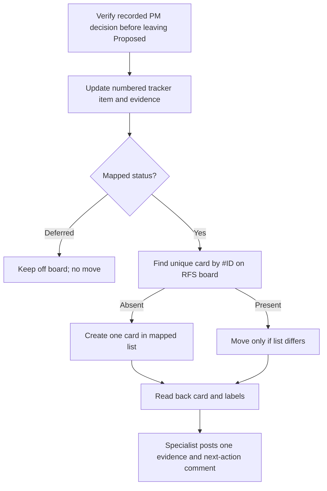

# RFS Trello board mirror

**Connected board:** [RFS BACKLOG TASKS](https://trello.com/b/vF796eiJ/rfs-backlog-tasks) (Valerio Gerardi's Trello workspace). The five task-status lists are mapped below. On 23 November 2026, the coordinator confirmed that a single empty **Open** list was at the front of the board. The account connector is already available to the agent. No Trello API key belongs in this repository.

The [Markdown improvement tracker](../product/IMPROVEMENT_TRACKER.md) remains the authoritative record for task IDs, detailed status, acceptance criteria, tests, Git, Supabase, and Vercel evidence. Trello is a visual mirror of the current task status, not a second backlog. The agent synchronizes a card during a task handoff; it does **not** run a continuous background sync or treat a board move as proof of completion.

Every specialist also records one concise output comment on the matching numbered card after a meaningful role handoff, including an unfinished result. The comment states the role, actual evidence, remaining gap or blocker, and next action/PM decision; it omits secrets and personal staff/customer data. If status changes, update the tracker and board list first. Comments are progress notes, not acceptance or Done evidence by themselves. See `ticket-comment-handoff` under `.agents/skills/`.

| Tracker state | Trello list | Rule |
| --- | --- | --- |
| Proposed | Open | Reserved for unreviewed knowledge-base proposals. |
| Open, before pickup | READY | The canonical actionable backlog state for a newly added numbered task. |
| Partial | IN PROGRESS | Work or verification remains incomplete. |
| Verify release | IN REVIEW | Implementation is present but release checks or PM acceptance remain. |
| Done | DONE | Only after the tracker's acceptance and full-test evidence supports Done, including PM acceptance where required. |
| Deferred | No card | The PM chose to leave deferred #5 off the board rather than mislabel it. |

[`resolveBoardList`](../../tools/agent_workflow/status.mjs) reads the [policy mapping](../../.agents/board-policy.json) and accepts `{ trackerStatus, origin, pmReviewed, pmDecisionRef }`. Use `knowledge_base` for the source of a knowledge-base proposal throughout its lifecycle and `manual` for other tasks. For any knowledge-base status after Proposed, pass `pmReviewed: true` and a nonempty reference to the recorded PM decision. The coordinator checks the referenced decision against the proposal and intended next state before updating the tracker. A reference identifies evidence for that check. Research publication, proposal intake, and calling the resolver confer no authority to promote or implement an item.

Card titles begin with the stable tracker number, for example `#58 — Establish the PM-led sequential AI delivery team`. Each description must contain the work scope, testable acceptance criteria, and tracker status/source; the tracker retains detailed test and release evidence. Before creating or moving a card, check the board and its lists, then match the number and title; stop on duplicates or ambiguity. Create cards one at a time when a new item is added or picked up. The PM requested a one-time import of the existing non-deferred tracker items on 7 November 2026; this does not authorize routine bulk imports, changes to other boards, labels, or archiving.

**One-time import verified 7 November 2026:** all 62 non-deferred tracker IDs appear exactly once, each with Description and Acceptance criteria sections. The lists hold 40 READY, 14 IN PROGRESS, 3 IN REVIEW, and 5 DONE cards. The PM explicitly excluded deferred #5. Later work must update the tracker first, then keep the matching card's description, criteria, and list in sync; an existing card is edited rather than duplicated.

If the Trello connector is unavailable, keep the Markdown tracker correct and report the card as unsynced. A card can move back from DONE to IN PROGRESS if verified evidence requires the tracker to reopen; the tracker change comes first. See [`AGENTS.md`](../../AGENTS.md), [the sequential team workflow](RFS_AI_TEAM_WORKFLOW.md), and the `move-board-cards` skill for the operational rule.

PM comment preference (19 November 2026): use short **Result**, **Checked**, **Next** and **Evidence** sections, with bullets and descriptive links. The template is maintained in .agents/skills/ticket-comment-handoff/SKILL.md. Keep original dates and status-at-the-time when reformatting historical comments.

## Card labels

The [board policy](../../.agents/board-policy.json) defines the exact label names for the RFS board. Select one or more substantive domains based on the task's scope. UI/UX uses **Front end Dev**. Select exactly one delivery tier from task risk and verification needs. **QUICK** uses focused independent checks, **STANDARD** adds relevant regressions, and **FULL** adds the necessary risk review. Task number, list and product priority do not select the tier.

The [68-card plan](TRELLO_LABEL_PLAN.json) records scope rationales and the 22 November card snapshot. It is **applied and independently verified** on all 68 cards: exact IDs/titles/original lists and labels preserved, with 231 assignments; helper replay passed 68 checks with zero additions. Earlier preparation records are retained as history. For new numbered cards, use current triage. For routine status or description changes, omit label fields and verify that every prior label ID survives readback, including unrelated labels.

For an authorized label update, use this procedure.

1. Read the documented board by ID, its complete current label catalog, and the relevant cards. Match the stable card ID, tracker number and title before using a snapshot entry. Preflight the entire planned batch before the first write.
2. Import `planLabelAdditions` from [`labels.mjs`](../../tools/agent_workflow/labels.mjs). Pass `{ task, boardLabels, currentLabelIds }`, with exact `{ id, name }` entries in the catalog and current label IDs from the matched card. For a new card's preflight, use an empty current ID list. The result contains only missing IDs in policy order.
3. Surface missing label names, duplicate named labels, unresolved current IDs and any different or additional existing tier before applying labels. Keep existing labels intact and resolve ambiguity with the coordinator. Unnamed color labels are tracked by ID. Use exact, case-sensitive names for matching.
4. Add only the planned IDs using an additive card-label operation. If the connector only offers full replacement, report the labeling action as blocked. Read back each updated card to confirm every prior label ID and every intended addition, including a single delivery tier. For retries, reread the catalog and card and replan from observed state. An empty plan needs no write.

## Epic indexes

The [board policy](../../.agents/board-policy.json) defines six standard index cards in **EPICS**, each with its domain and **FULL** labels. The cards have unnumbered titles and sit outside the five task-status lists. A numbered task keeps its status list and may appear in several indexes based on its domain labels. The Markdown tracker remains authoritative for numbered status and acceptance evidence.

The published Trello card-type catalog lists no dedicated Epic card type, and Trello documents mirroring as a paid feature. This board uses standard cards with direct links to the numbered tasks. [Trello card types](https://support.atlassian.com/trello/docs/card-types/) · [Trello card mirroring](https://support.atlassian.com/trello/docs/mirroring-cards/)

At an authorized grouping handoff, the coordinator reads all current numbered cards across the five status lists, including Open and DONE, with every page of cards and labels. Confirm each card's board and numbered tracker match. Pass the fresh `{ id, name, url, labels: [{ id, name }], labelsHasMore: false }` records to [`buildEpicGroups`](../../tools/agent_workflow/epics.mjs). Resolve any validation error before writing. The helper gives all six exact titles, label names, and descriptions with numerically sorted child links and their current tier tags.

Match each index by its exact title on the board and verify its **EPICS** list before editing. Stop on ambiguous matches. For existing index cards, refresh only the generated **Linked tasks** section and preserve manual **Notes** and other content. Leave matching descriptions alone. Apply authorized label additions using the same additive procedure and preserve prior labels. Read back the six index cards, checking their titles, list, labels, links, tier tags, and retained notes. Keep numbered task cards, their lists and their labels intact throughout the grouping refresh.
