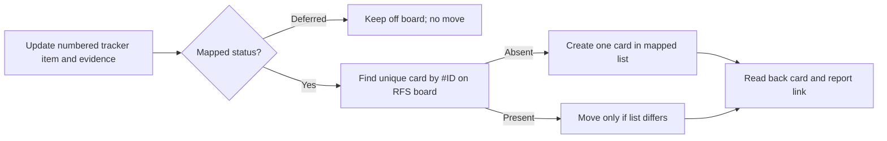

# RFS Trello board mirror

**Connected board:** [RFS BACKLOG TASKS](https://trello.com/b/vF796eiJ/rfs-backlog-tasks) (Valerio Gerardi's Trello workspace). **Setup checked:** 7 November 2026. The board has the four lists below; the account connector is already available to the agent. No Trello API key belongs in this repository.

The [Markdown improvement tracker](../product/IMPROVEMENT_TRACKER.md) remains the authoritative record for task IDs, detailed status, acceptance criteria, tests, Git, Supabase, and Vercel evidence. Trello is a visual mirror of the current task status, not a second backlog. The agent synchronizes a card during a task handoff; it does **not** run a continuous background sync or treat a board move as proof of completion.

| Tracker state | Trello list | Rule |
| --- | --- | --- |
| Open, not picked up | READY | A newly added numbered task can get one card here. |
| Partial | IN PROGRESS | Work or verification remains incomplete. |
| Verify release | IN REVIEW | Implementation is present but release checks or PM acceptance remain. |
| Done | DONE | Only after the tracker's acceptance and full-test evidence supports Done, including PM acceptance where required. |
| Deferred | No card | The PM chose to leave deferred #5 off the board rather than mislabel it. |

Card titles begin with the stable tracker number, for example `#58 — Establish the PM-led sequential AI delivery team`. Each description must contain the work scope, testable acceptance criteria, and tracker status/source; the tracker retains detailed test and release evidence. Before creating or moving a card, check the board and its lists, then match the number and title; stop on duplicates or ambiguity. Create cards one at a time when a new item is added or picked up. The PM requested a one-time import of the existing non-deferred tracker items on 7 November 2026; this does not authorize routine bulk imports, changes to other boards, labels, or archiving.

**One-time import verified 7 November 2026:** all 62 non-deferred tracker IDs appear exactly once, each with Description and Acceptance criteria sections. The lists hold 40 READY, 14 IN PROGRESS, 3 IN REVIEW, and 5 DONE cards. The PM explicitly excluded deferred #5. Later work must update the tracker first, then keep the matching card's description, criteria, and list in sync; an existing card is edited rather than duplicated.

If the Trello connector is unavailable, keep the Markdown tracker correct and report the card as unsynced. A card can move back from DONE to IN PROGRESS if verified evidence requires the tracker to reopen; the tracker change comes first. See [`AGENTS.md`](../../AGENTS.md), [the sequential team workflow](RFS_AI_TEAM_WORKFLOW.md), and the `move-board-cards` skill for the operational rule.
