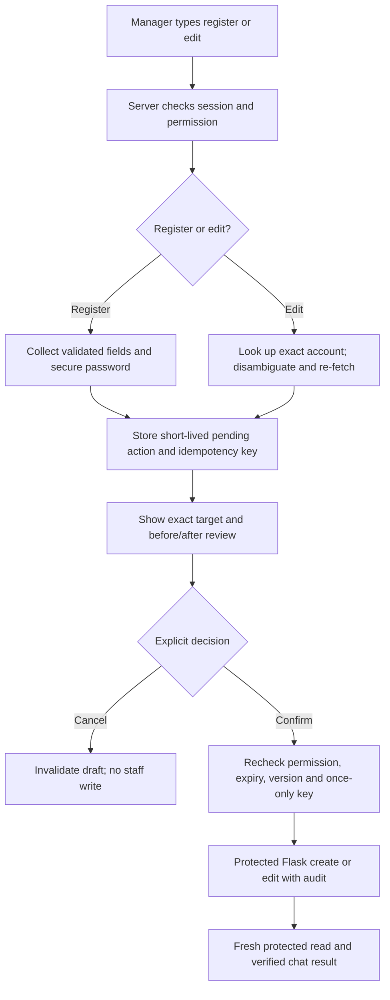
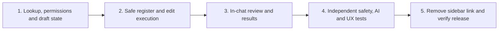

# Staff registration and editing in RFS AI — delivery plan

Status: **proposed scope, not implemented** (6 November 2026). This is the focused plan for [backlog #54](../product/IMPROVEMENT_TRACKER.md), not a second backlog. The PM has asked to remove Staff Management from the sidebar and complete **register** and **edit** inside the bot. The live app still shows the sidebar link and opens the entire Staff Management workspace inside chat; that is not the requested conversational experience.

## Product boundary

- A manager starts with a typed request such as “register a new staff member” or “edit Valerio's operational role.” The bot asks for missing details and completes the flow **without navigating to the Staff Management page**. A compact secure password field and an explicit Confirm/Cancel control are justified exceptions to plain-text conversation; do not ask for a password in a chat message.
- Registration preserves the current active-account workflow for the first release: full name, unique email, initial password and confirmation, application role, and operational role (required when the application role is `staff`). The current backend supports these fields. Invitation-by-link is a separate product decision, not a silent replacement.
- Editing is limited to the current API contract: full name, application role, and operational role. Email is not editable; password recovery and status changes are separate actions. The last active manager cannot be demoted.
- Existing search/filter/view, suspend, deactivate, reactivate, and reset-link actions must remain available inside the protected bot workspace when the sidebar entry goes away. Making **those** actions fully conversational is not part of this first increment; do not remove their current in-chat controls or protected API access.
- Keep `/dashboard/staff` guarded as a recovery route initially, but remove its visible sidebar link only after the bot journeys pass release checks. Reports remains view-only; Settings and all other sidebar entries are unchanged. No staff record, password, or activation/reset link goes to the AI model.

## Features required

| ID | Priority | Feature and implementation | Acceptance signal |
| --- | --- | --- | --- |
| 54-S1 | Must | Recognize typed register/edit requests deterministically, including follow-up replies. Keep model classification optional for vague, non-sensitive intent only; never let model output execute a write. | Explicit requests work with the model unavailable; unsupported or ambiguous messages do not mutate accounts. |
| 54-S2 | Must | Add protected staff lookup and identity disambiguation inside chat. Search by name/email and fetch the selected account's current details; distinguish people with the same name by email/status, using stable account ID internally. | “Edit Valerio Gerardi” asks which account when multiple matches exist; no account is guessed. Restricted users cannot retrieve results. |
| 54-S3 | Must | Build a bounded, multi-turn action draft for each manager: collect missing non-secret fields, allow correction/cancel, expire abandoned drafts, and avoid mixing a new request with a pending action. Store authoritative pending state server-side, not solely in the browser or model transcript. | Reopen/refresh or conflicting messages cannot accidentally confirm stale or different details. |
| 54-S4 | Must | Complete registration in chat. Validate full name, email, application role, operational role, and 12–128-character password/confirmation against the existing backend rules. Capture the password only in a secure, non-chat input sent directly to the protected executor; never echo or persist plaintext. | A manager can register one valid active account entirely in the bot; duplicate email and invalid fields receive specific, safe feedback. |
| 54-S5 | Must | Complete editing in chat. Show the selected account's current values; accept only full name, application role, and operational role changes, including clearing an optional role where permitted. Re-fetch before saving and reject stale or prohibited changes. | A manager can edit the intended account without navigation; unchanged/uneditable fields are not silently changed; last-manager protection remains enforced. |
| 54-S6 | Must | Show an in-chat review step with the exact target, action, and before/after values; require a separate Confirm or Cancel interaction. Do not treat a natural-language “yes” alone as authority for a sensitive write. | No POST/PATCH occurs while collecting details or displaying the review; Cancel makes no change. |
| 54-S7 | Must | Add durable once-only execution for confirmed writes: server-issued action ID/idempotency key, expiry, expected record version for edits, transaction-safe result reuse, and existing staff-account audit. This requires a reviewed Supabase PostgreSQL migration and protected Flask/Next.js wiring; store no plaintext password or secret link. | Double-click, network retry, refresh, or a repeated confirmation cannot create two accounts or apply an edit twice; stale edits fail clearly. |
| 54-S8 | Must | Enforce manager identity and `manage_staff_accounts` permission at the chat boundary and again in Flask; validate origin, input shapes, role IDs, request size, and rate limits. Keep staff PII and secrets out of Cloudflare prompts, browser logs, analytics, and general chat history. | Signed-out/non-manager requests fail; forged IDs or confirmation payloads fail; model outage cannot bypass checks. |
| 54-S9 | Must | Return a verified post-write result in chat: account name/email/roles/status, what changed, and a clear error/retry path. Refresh any in-chat staff list and make no success claim until Flask confirms the write. | The account shown after register/edit matches a fresh protected read; failed requests do not display success or trigger hidden retries. |
| 54-S10 | Must | Remove the Staff Management sidebar item **after** parity checks. Keep other existing account controls reachable in the bot; retain direct route authorization and a rollback path. | No sidebar link remains for any role, while managers can still register/edit and reach the other current staff actions in chat. |
| 54-S11 | Must | Make the conversation and secure fields usable in the left dock and narrow layouts: keyboard flow, focus restoration, accessible labels/status, clear edit/confirm/cancel states, and no full-page table as the primary interaction. | Desktop/mobile and keyboard/screen-reader checks can complete both journeys without sidebar navigation. |
| 54-S12 | Must | Add unit, API-contract, component, security, and authenticated end-to-end tests for success, ambiguity, invalid fields, duplicate email, stale edit, denial, cancellation, model failure, and duplicate confirmation. Stage a protected preview, verify with test accounts, monitor errors, and only then remove/release the sidebar link. | Independent QA, security, chatbot-evaluation, and UX reviews pass; the PM accepts the live journeys before #54 is Done. |

## Proposed manager workflow

This is an intended boundary, not an implemented API contract. The implementation must choose a transaction-safe handoff between the pending-action store and Flask write so a retry cannot perform a second mutation; the diagram alone does not solve that atomicity problem. The password never enters typed chat text or model context.

## Delivery order

Use the existing protected Flask staff endpoints for the business operation; add only the action-draft/idempotency boundary needed for safe conversational writes. The AI may interpret a non-sensitive request, but the server chooses allowable fields and the manager confirms the exact transaction. Apply any migration to the database only with separate PM approval. Keep Git push, migration application, Vercel Preview, and Production as separate release states in the tracker.

## Decision to confirm before implementation

This plan assumes the **existing active-account registration with a manager-supplied initial password**. If the PM wants invitation-by-link instead, the registration journey, secure delivery, and acceptance tests change. No account or database record is changed by this planning document.
